# ggbasket

**Learn from basketball games, NBA and EuroLeague.** ggbasket reads play-by-play, box-score and shot data
from both leagues into one layout, computes the measures analysts use (win probability, on/off, four
factors, shot quality, pressure) and draws each answer as a finished, story-first ggplot2 figure.

```r
devtools::install_github("loukesio/ggbasket")   # licensed users only, see Licence below
library(ggbasket)

# one game: the 2025 NBA Finals Game 7 is bundled
plot_game_flow(pbp_games, "401766128")
plot_win_probability(win_probability(pbp_games), "401766128")
box_score(pbp_games)                        # player box score with minutes and plus-minus

# a whole season, either league
nba <- pbp_from_espn(hoopR::load_nba_pbp(seasons = 2025))   # ESPN, via hoopR
el  <- fetch_euroleague_pbp(season = 2024)                  # official EuroLeague API, with shot locations
on_off(el, team = "PAN")
```

## Creating a match report

A report holds:
* the key findings in words;
* the game flow;
* win probability, with the plays that swung it;
* what decided the result, and who mattered;
* every shot;
* box scores, clutch time and line-ups.

It is one self-contained HTML file with the figures inside, ready to e-mail or post. Examples:
[Olympiacos 84-78 Olimpia Milano](https://loukesio.github.io/ggbasket-site/reports/OLY-MIL-2026-10-30.html) and
[Oklahoma City 103-91 Indiana, 2025 NBA Finals Game 7](https://loukesio.github.io/ggbasket-site/reports/OKC-IND-2025-06-22.html).

**1. Find the game.**

```r
library(ggbasket)

# EuroLeague: every played game of the season, with its game code
euroleague_games(2026, team = "OLY")      # 2026 = the 2026/27 season
#>   game date       round home away home_name          away_name            home_score away_score
#>     90 2026-10-30     9 OLY  MIL  Olympiacos Piraeus Armani Olimpia Milan         84         78

# NBA: the games on a date, with ESPN's game id
nba_games("2025-06-22")
#>   game      date       home away home_name             away_name      home_score away_score
#>   401766128 2025-06-22 OKC  IND  Oklahoma City Thunder Indiana Pacers        103         91
```

**2. Make the report.** This takes about 10 seconds. The file is saved in your working directory as
`<home>-<away>-<date>.html` and opens in your browser.

```r
match_report(90, "EuroLeague", season = 2026)
match_report("401766128", "NBA")
```

**3. Optional extras.**

```r
match_report(90, "EuroLeague", season = 2026,
             context = TRUE,                                   # compare with both teams' season (about a minute)
             names   = c(OLY = "Olympiacos", MIL = "Milano"),  # shorter display names
             colours = c("#C8102E", "#2E4057"),                # team colours, home first
             file    = "reports/olympiacos-milano.html")       # where to save it
```

**4. Share it.** Send the HTML file as an attachment, put it on a shared drive, or publish it on a website. It
needs no R and no internet connection to open. For a quick message, `match_story()` gives the key findings as
text:

```r
match_story(fetch_game(90, "EuroLeague", season = 2026))
#> "**Olympiacos Piraeus beat Armani Olimpia Milan by 6** (84-78). There were 14 lead changes and 9 ties ..."
#> "**What decided it: turnovers.** It was worth about +5.9 points to Olympiacos Piraeus (18 turnovers against 14) ..."
```

**5. Report on several games at once.** Every game of Olympiacos's season so far:

```r
games <- euroleague_games(2026, team = "OLY")
for (g in games$game) match_report(g, "EuroLeague", season = 2026, open = FALSE)
```

## Case study: what can we learn from one game?

**Olympiacos 84-78 Olimpia Milano**, EuroLeague round 9, 30 October 2026. Everything below comes from
the game's play-by-play, downloaded with one call, and is redrawn by `Rscript gallery/make_case.R`.

```r
el <- fetch_euroleague_pbp(2026)            # the season so far, with shot locations
gm <- subset(el, game_id == "E2026_90")
```

**1. How did the game unfold?** The first half was a coin toss: 14 lead changes and 9 ties, with five runs
of six or more unanswered points. Milano led for the last time in the 21st minute. Olympiacos's biggest
run was 9-0 and their biggest lead 11; Milano never led by more than 3.


```r
game_summary(gm)                      # lead changes, ties, biggest leads, best run
scoring_runs(gm, min_points = 6)
plot_game_flow(gm, min_run = 6, colours = c("#C8102E", "#2E4057"))
```

**2. Which plays decided it?** Olympiacos were favourites from the third quarter on, up to 95% when they led
by 11. Milano's 7-0 run early in the fourth made it close again, and the biggest swings all came late:
* Jason Burnell's three made it 75-73 and took 18 points off Olympiacos's chances.
* Cory Joseph answered with a basket for 77-73 (+15).
* Leandro Bolmaro's three at 79-76 was Milano's last push.

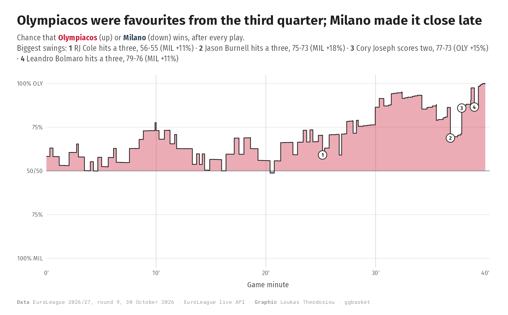

```r
wp <- win_probability(gm)
plot_win_probability(wp, n_key = 4, colours = c("#C8102E", "#2E4057"))
```

**3. Why did Olympiacos win?** Not by shooting: Milano's effective field-goal percentage was higher
(66% against 64%). The margin came from possessions.
* **Turnovers:** Milano lost the ball 18 times against Olympiacos's 14 (26% of possessions against 20%),
  worth about +6.5 points.
* **Offensive rebounds:** Olympiacos grabbed 42% of their own misses against Milano's 33%, worth +3.4.
* **Free throws:** almost level (10 made against 11).


```r
gf <- game_factors(box_score(el, by = "team"))   # fitted on the season; one game alone also works
plot_game_factors(gf, "E2026_90", team = "OLY")
```

**4. Was this a typical Olympiacos game?** No. Against their eight other games so far:
* It was their best shooting night (64% eFG) and the most turnovers they have forced (26%).
* It was also the best shooting they have allowed (66%), so the defence won the ball back rather than
  contesting shots.


```r
oly <- four_factors(box_score(subset(el, hometeam == "OLY" | awayteam == "OLY"), by = "team"))
subset(oly, team == "OLY")[, c("game_id", "efg", "tov_pct", "orb_pct", "o_efg", "o_tov_pct", "drb_pct")]
```

**5. Who made the difference?** Codi Miller-McIntyre (24 points, 4 of 9 threes, +18 on the floor) and
Sasha Vezenkov (23 points, 8 of 10 twos) moved Olympiacos's win probability the most. Win probability added
counts a player's own plays and a fifth of every opponent play while they were on the floor. For Milano,
Moses Wright and Burnell added the most; RJ Cole scored 17 but was −10 on the floor.


```r
wpa <- win_probability_added(wp)
plot_wpa(wpa, colours = c(OLY = "#C8102E", MIL = "#2E4057"))
box_score(gm)                          # points, shooting, plus-minus for every player
```

**6. Where did the shots come from?** Olympiacos attacked the paint: 37 twos at 68%, against Milano's 25.
Milano lived behind the arc and made more threes: 11 of 26 (42%), against Olympiacos's 8 of 21 (38%).


```r
sh <- as_ggbasket_shots(gm, league = "EuroLeague")
plot_shot_density(sh, facet = "team", points = TRUE, league = "EuroLeague")
```

**7. Who did Olympiacos play best with?** In this game, Olympiacos were best with Miller-McIntyre on the
floor. Over the nine games so far, Vezenkov is the steadiest player (median Game Score 15.5), and the team
is +21 per 100 possessions with Jean Montero on the floor against +2 without him. These are small
early-season samples, worth watching rather than concluding from.

| | |
|---|---|
| 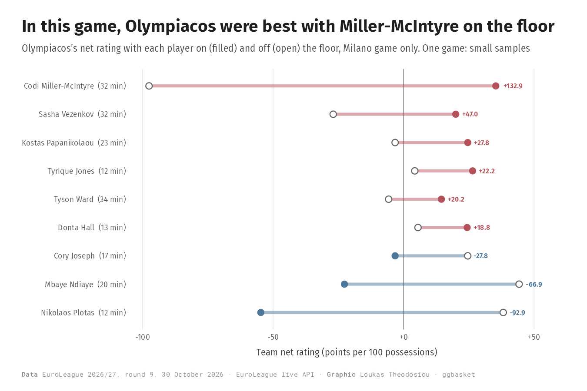 | 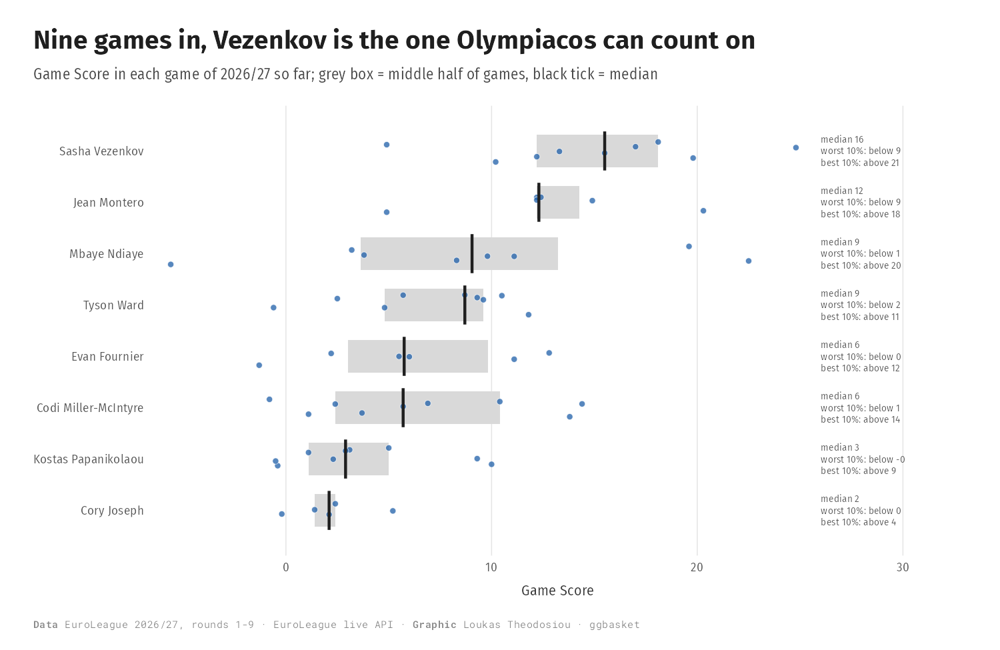 |

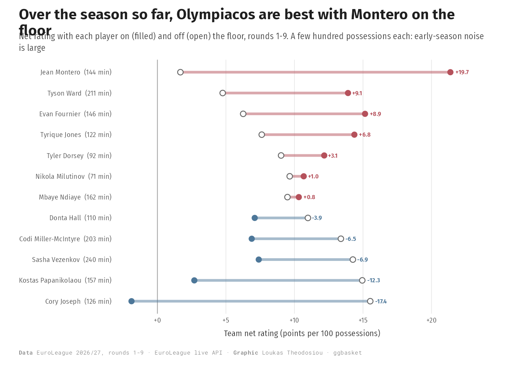

```r
plot_on_off(on_off(gm, team = "OLY", min_minutes = 8))
ob <- game_score(box_score(subset(el, hometeam == "OLY" | awayteam == "OLY")))
plot_consistency(subset(ob, team == "OLY"), players = c("Sasha Vezenkov", "Jean Montero", "Tyson Ward"))
plot_on_off(on_off(subset(el, hometeam == "OLY" | awayteam == "OLY"), team = "OLY", min_minutes = 60))
```

**In one sentence:** Milano shot better, but Olympiacos won the possession battle. Four more turnovers forced
and three more offensive rebounds were worth about 10 points. Miller-McIntyre and Vezenkov turned those chances into points, and
Cory Joseph's basket at 77-73 settled a game that was level for its first 21 minutes.

## What you can learn from a game

| Question | Functions |
|---|---|
| How did the game unfold? Who made the runs? | `game_flow()`, `scoring_runs()`, `plot_game_flow()` |
| Which plays decided it? | `win_probability()`, `plot_win_probability()` |
| Why did the winner win: shooting, turnovers, rebounds or free throws? | `game_factors()`, `plot_game_factors()` |
| Was it a classic? | `game_summary()`: lead changes, biggest leads, best run, excitement, comeback |
| Who played well? | `box_score()`, `game_score()`, `win_probability_added()` |
| Everything at once, to share | `euroleague_games()`, `nba_games()`, `match_report()`, `match_story()`, `fetch_game()` |

## What you can learn from many games

| Question | Functions |
|---|---|
| Is the team better with this player on the floor? Which line-ups work? | `stints()`, `on_off()`, `lineups()`, `plot_on_off()` |
| Who can you count on every night? | `game_score()`, `plot_consistency()` |
| Who performs when it is close? | `clutch_time()` + any other function |
| Who creates for whom? | `assist_network()`, `plot_assist_network()`, `plot_assist_matrix()`, `plot_assist_roles()` |
| Does pressure (shot clock, score, streaks, end of period) change shooting? | `pressure_situations()`, `pressure_effects()`, `plot_pressure()` |
| How does a shot's value change with distance or shot clock? | `shot_curve()`, `plot_shot_curve()` |

## Teams, players and shots

| Topic | Metrics | Plots |
|---|---|---|
| Teams | `possessions()`, `four_factors()`, `team_ratings()`, `team_shot_profile()`, `expected_wins()`, `gini()`, `lorenz()` | `plot_net_rating()`, `plot_factor_ranks()`, `plot_team_ratings()`, `plot_luck()`, `plot_lorenz()`, `plot_ratings()`, `plot_four_factors()` |
| Player impact | `rapm()`, `win_probability_added()`, `on_off()`, `lineups()` | `plot_rapm()`, `plot_wpa()`, `plot_on_off()`, `plot_lineups()` |
| Players | `player_rates()` (TS%, usage, AST%, rebound, steal, block and turnover rates), `percentile_rank()`, `shrink_rate()` | `plot_profile()`, `plot_quadrant()`, `plot_joint()`, `plot_fit()`, `plot_spread()`, `plot_ranked()` |
| Shots | `shot_zone()`, `summarise_zones()`, `bin_shots_hex()`, `expected_fg()`, `shot_making()` | `plot_shot_hex()`, `plot_shot_zones()`, `plot_shot_density()`, `plot_shot_making()` |
| Patterns | `association()`, `cluster_quality()` | `plot_association()`, `plot_corr_matrix()`, `plot_similarity_map()`, `plot_cluster_quality()`, `plot_cluster_profiles()` |
| Courts and style | `court_spec()`, `court_lines()`, `ggbasket_fonts()` | `geom_court()` (NBA and FIBA), `theme_ggbasket()`, `theme_court()`, `colour_text()`, `ggbasket_caption()` |

## Gallery

Every figure takes one to three lines of code once the data is loaded. Open **Code for these figures** under
each section for the exact calls; the shared setup is:

```r
library(ggbasket); library(ggplot2); library(dplyr)
# season play-by-play, built once by data-raw/make_pbp.R (or with fetch_euroleague_pbp() / pbp_from_espn())
nba_pbp <- arrow::read_parquet("nba_pbp_2024.parquet"); el_pbp <- arrow::read_parquet("el_pbp_2024.parquet")
nba_reg <- filter(nba_pbp, phase == "regular"); el_reg <- filter(el_pbp, phase == "regular")
nba_sh <- subset(shots_2024, league == "NBA"); el_sh <- subset(shots_2024, league == "EuroLeague")
ff <- four_factors(team_seasons)
g7 <- "401766128"; okc <- "#007AC1"   # cap_* are captions made with ggbasket_caption("...")
```

Every figure below comes from real 2024/25 NBA and EuroLeague data; `Rscript gallery/make_gallery.R` redraws
them all.

### One game

| | |
|---|---|
| **Game flow.** The lead through Game 7 of the 2025 NBA Finals, with scoring runs. `plot_game_flow()` | **Win probability.** The season's wildest game, with the plays that swung it. `plot_win_probability()` |
|  |  |
| **Why they won.** Game 7's margin split into the four factors. `plot_game_factors()` | **A EuroLeague final.** Monaco against Fenerbahce, 2025. `plot_game_flow()` |
| 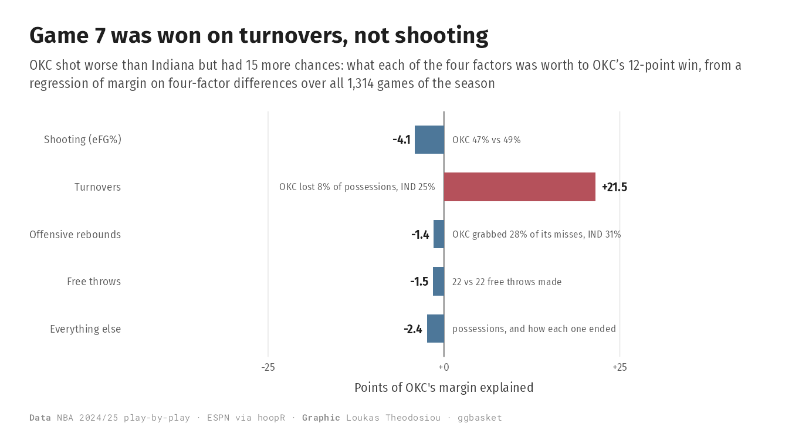 | 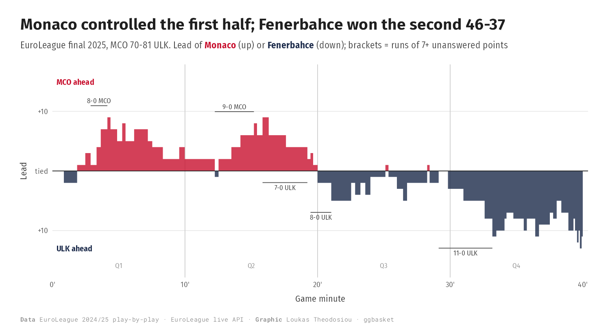 |
| **Every shot of a game.** Shot heatmap and makes and misses for both finalists. `plot_shot_density(points = TRUE)` | |
| 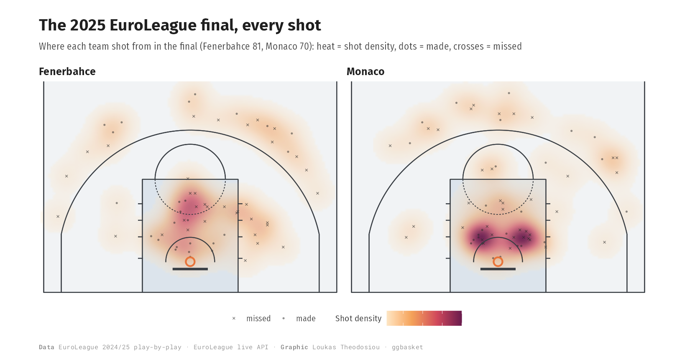 | |

<details><summary><b>Code for these figures</b></summary>

```r
out(plot_game_flow(nba_pbp, g7, min_run = 7, colours = c(okc, "#B8860B"),
                   title = "Game 7 was close for 27 minutes, then OKC ran away",
                   subtitle = paste("2025 NBA Finals, Game 7. Lead of", colour_text("Oklahoma City", okc), "(up) or",
                                    colour_text("Indiana", "#B8860B"), "(down). Tyrese Haliburton tore his Achilles in the first quarter; OKC broke the game open with a **13-0 run** in the third. Brackets = runs of 7+ unanswered points"),
                   caption = cap_nba), "01_game_flow", 10, 5.5)
el_final <- "E2024_330"
f <- game_flow(filter(el_pbp, game_id == el_final)); last <- f[nrow(f), ]
half <- f[f$totalTime <= 1200, ]; half <- half[nrow(half), ]
out(plot_game_flow(el_pbp, el_final, min_run = 7, colours = c("#C8102E", "#1B2A4A"),
                   title = sprintf("Monaco controlled the first half; Fenerbahce won the second %d-%d",
                                   last$away_score - half$away_score, last$home_score - half$home_score),
                   subtitle = sprintf("EuroLeague final 2025, %s %d-%d %s. Lead of %s (up) or %s (down); brackets = runs of 7+ unanswered points",
                                      last$hometeam, last$home_score, last$away_score, last$awayteam,
                                      colour_text("Monaco", "#C8102E"), colour_text("Fenerbahce", "#1B2A4A")),
                   caption = cap_el), "02_game_flow_el", 10, 5.5)

gs <- game_summary(nba_reg)
top <- gs$game_id[which.max(gs$excitement)]
bx <- box_score(filter(nba_reg, game_id == top))
star <- bx[which.max(bx$pts), ]
wp <- win_probability(filter(nba_reg, game_id == top))
r <- gs[gs$game_id == top, ]
out(plot_win_probability(wp, top, n_key = 4, colours = c("#0E2240", "#78BE20"),
                         title = sprintf("The season's wildest game: %s scored %d and %s lost by one", star$player,
                                         as.integer(star$pts), star$team),
                         subtitle = sprintf("%s after two overtimes, %d lead changes. Chance that %s (up) or %s (down) wins after every play, from a two-parameter score model fitted on the season.",
                                            r$score, r$lead_changes, colour_text(r$hometeam, "#0E2240"),
                                            colour_text(r$awayteam, "#5A9A12")),
                         caption = cap_nba), "03_win_probability", 10, 6.3)

gf <- game_factors(box_score(filter(nba_pbp, phase %in% c("regular", "playoffs")), by = "team"))
out(plot_game_factors(gf, g7, team = "OKC",
                      title = "Game 7 was won on turnovers, not shooting",
                      subtitle = "OKC shot worse than Indiana but had 15 more chances: what each of the four factors was worth to OKC's 12-point win, from a regression of margin on four-factor differences over all 1,314 games of the season",
                      caption = cap_nba), "04_game_factors", 9, 5)
```

</details>

### A season of games

| | |
|---|---|
| **On/off.** Denver with and without each player. `plot_on_off()` | **Consistency.** Every game of eight stars. `plot_consistency()` |
| 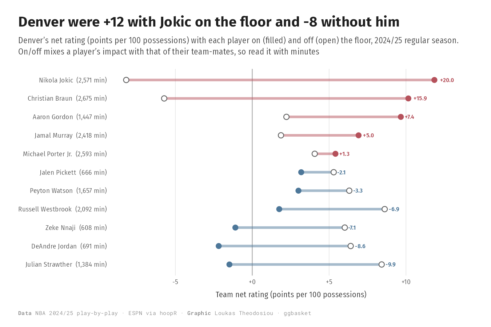 |  |
| **Assist network.** Who passes to whom in Denver. `plot_assist_network()` | **Passer to scorer.** The same network as a matrix. `plot_assist_matrix()` |
|  |  |
| **Hubs and two-man games.** `plot_assist_roles()` | **Pressure.** What changes the chance a shot goes in. `plot_pressure()` |
|  | 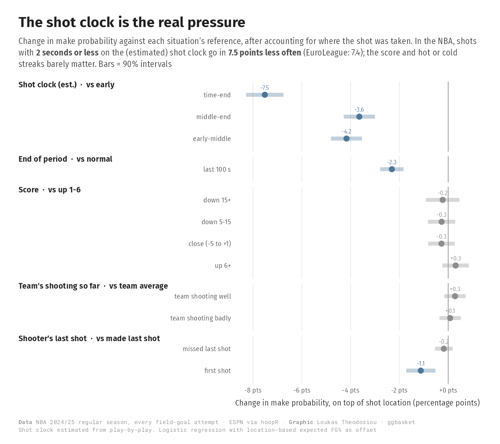 |
| **What goes with what.** Association between shot situations. `plot_association()` | **Shot clock.** Value of a shot as the clock runs down, both leagues. `plot_shot_curve()` |
| 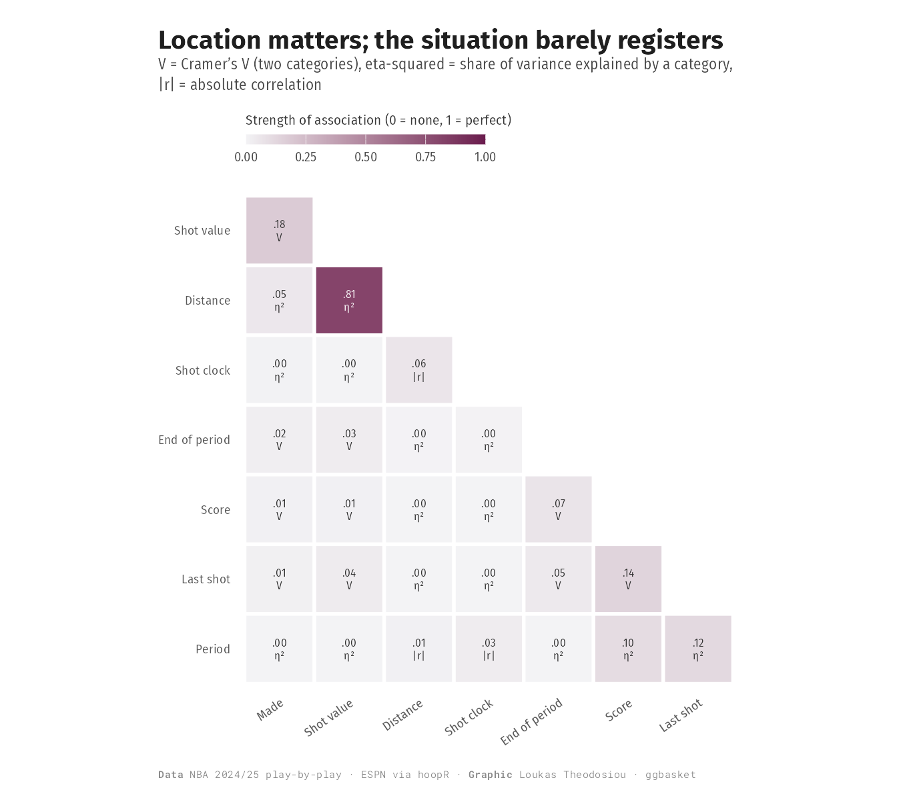 |  |

<details><summary><b>Code for these figures</b></summary>

```r
oo <- on_off(nba_reg, team = "DEN", min_minutes = 500)
j <- oo[oo$player == "Nikola Jokic", ]
out(plot_on_off(oo, n = 11,
                title = sprintf("Denver were %+.0f with Jokic on the floor and %+.0f without him", j$on_net, j$off_net),
                subtitle = "Denver's net rating (points per 100 possessions) with each player on (filled) and off (open) the floor, 2024/25 regular season. On/off mixes a player's impact with that of their team-mates, so read it with minutes",
                caption = cap_nba), "05_on_off", 9, 6)

bx <- game_score(box_score(nba_reg))
stars <- c("Nikola Jokic", "Shai Gilgeous-Alexander", "Giannis Antetokounmpo", "Luka Doncic", "Anthony Edwards",
           "Jayson Tatum", "Stephen Curry", "Victor Wembanyama")
out(plot_consistency(bx, stars, min_minutes = 15,
                     title = "Jokic's bad nights are other stars' good ones",
                     subtitle = "Game Score in every game of 2024/25 (Hollinger's box-score summary, about 10 = an average game, 40 = outstanding). Grey box = middle half of games, black tick = median",
                     caption = cap_nba), "06_consistency", 10, 7)

net <- assist_network(filter(nba_reg, team == "DEN"))
out(plot_assist_network(net, min_assists = 25, top_n = 9,
                        title = "Denver's offence runs through Jokic", caption = cap_nba), "07_assist_network", 10, 8)
out(plot_assist_matrix(net, top_n = 9, title = "Denver 2024/25: passer to scorer", caption = cap_nba),
    "08_assist_matrix", 8.5, 7)
jk <- net$nodes[net$nodes$player == "Nikola Jokic", ]
out(plot_assist_roles(net, min_assists = 60,
                      title = sprintf("Jokic is the hub: %d assists, %.0f%% of Denver's, %.1f times the next player",
                                      as.integer(jk$assists), 100 * jk$ast_share,
                                      jk$assists / sort(net$nodes$assists, decreasing = TRUE)[2]),
                      caption = cap_nba), "09_assist_roles", 9, 6.5)

ps_nba <- expected_fg(pressure_situations(nba_reg, league = "NBA", orb_reset = 14))
ps_el <- expected_fg(pressure_situations(el_reg, league = "EuroLeague", orb_reset = 14))

e_nba <- pressure_effects(ps_nba); e_el <- pressure_effects(ps_el)
te <- function(e) 100 * e$effect[e$situation == "shot_clock" & e$level == "time-end"]
out(plot_pressure(e_nba,
                  title = "The shot clock is the real pressure",
                  subtitle = sprintf("Change in make probability against each situation's reference, after accounting for where the shot was taken. In the NBA, shots with **2 seconds or less** on the (estimated) shot clock go in **%.1f points less often** (EuroLeague: %.1f); the score and hot or cold streaks barely matter. Bars = 90%% intervals",
                                     abs(te(e_nba)), abs(te(e_el))),
                  caption = ggbasket_caption("NBA 2024/25 regular season, every field-goal attempt · ESPN via hoopR",
                                             note = "Shot clock estimated from play-by-play. Logistic regression with location-based expected FG% as offset")),
    "10_pressure", 9, 8)

ps_nba$dist <- sqrt(ps_nba$x^2 + ps_nba$y^2)
set.seed(1)
s <- ps_nba[sample(nrow(ps_nba), 40000), ]
out(plot_association(association(s, c(Made = "made", `Shot value` = "value", Distance = "dist",
                                      `Shot clock` = "shot_clock_left", `End of period` = "period_end",
                                      Score = "score_diff", `Last shot` = "prev_miss", Period = "period")),
                     title = "Location matters; the situation barely registers",
                     caption = cap_nba), "11_association", 9, 8)

both <- bind_rows(ps_nba, ps_el)
sc <- shot_curve(both, "shot_clock_left", by = "league", outcome = "points", n_boot = 100, bw = 1.2)
out(plot_shot_curve(sc, xlab = "Seconds left on the shot clock (estimated)",
                    title = "As the shot clock runs down, so does the value of a shot",
                    subtitle = paste0("Expected points per field-goal attempt by time left on the shot clock, in the ",
                                      colour_text("NBA", "NBA"), " and the ", colour_text("EuroLeague", "EuroLeague"),
                                      ". Early shots (mostly transition) are worth 1.25-1.35 points; with 2 seconds left, under 1. EuroLeague attempts are worth more at almost every clock reading. Line width = where shots are taken; band = 90% bootstrap"),
                    caption = cap_both) + scale_x_reverse(), "12_shot_clock", 9, 5.8)
```

</details>

### Shots on the court

| | |
|---|---|
| **Hexagons.** Four NBA stars: where they shoot and how well. `plot_shot_hex()` | **Hexagons, EuroLeague.** Four EuroLeague scorers. `plot_shot_hex()` |
|  | 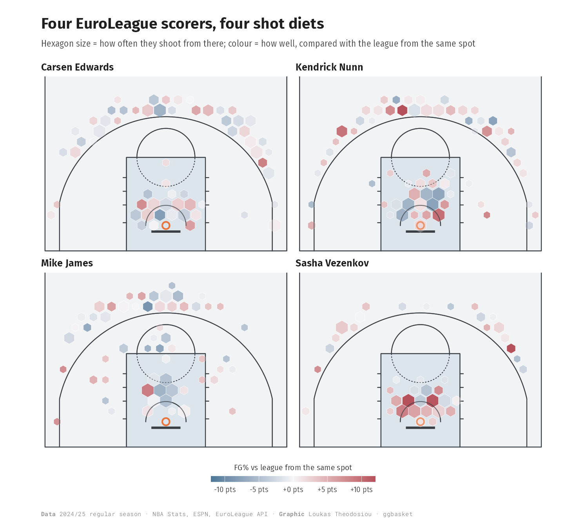 |
| **Zones.** Jokic by court zone against the league. `plot_shot_zones()` | **Zones on a FIBA court.** Vezenkov. `plot_shot_zones()` |
|  | 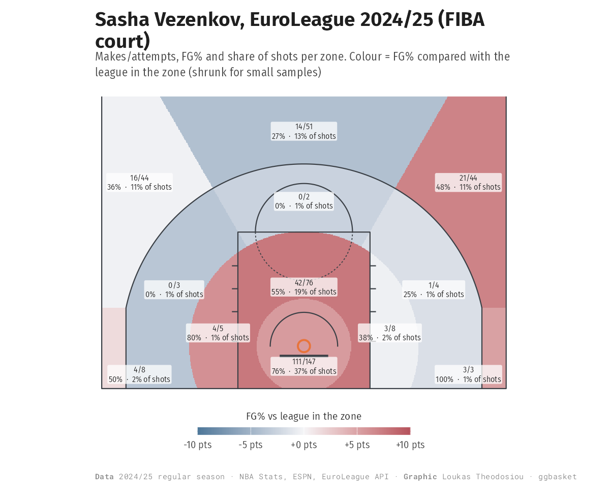 |
| **Shot diet.** Curry and Giannis against the average player. `plot_shot_density()` | **League against league.** EuroLeague shot locations against the NBA's. `plot_shot_density()` |
| 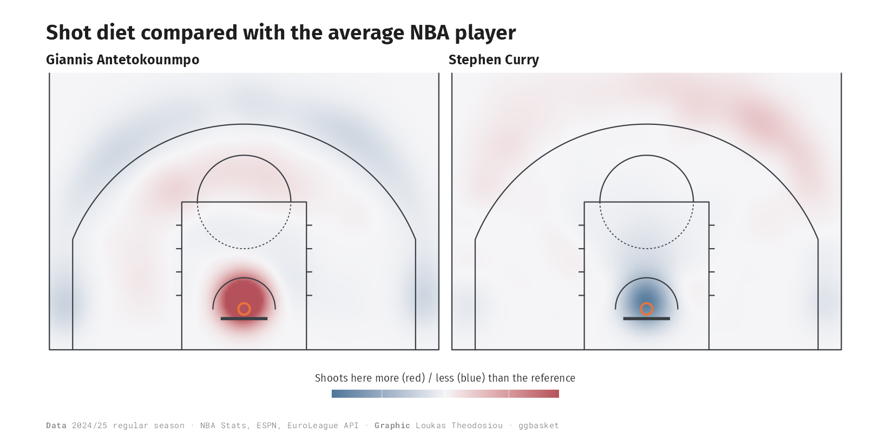 | 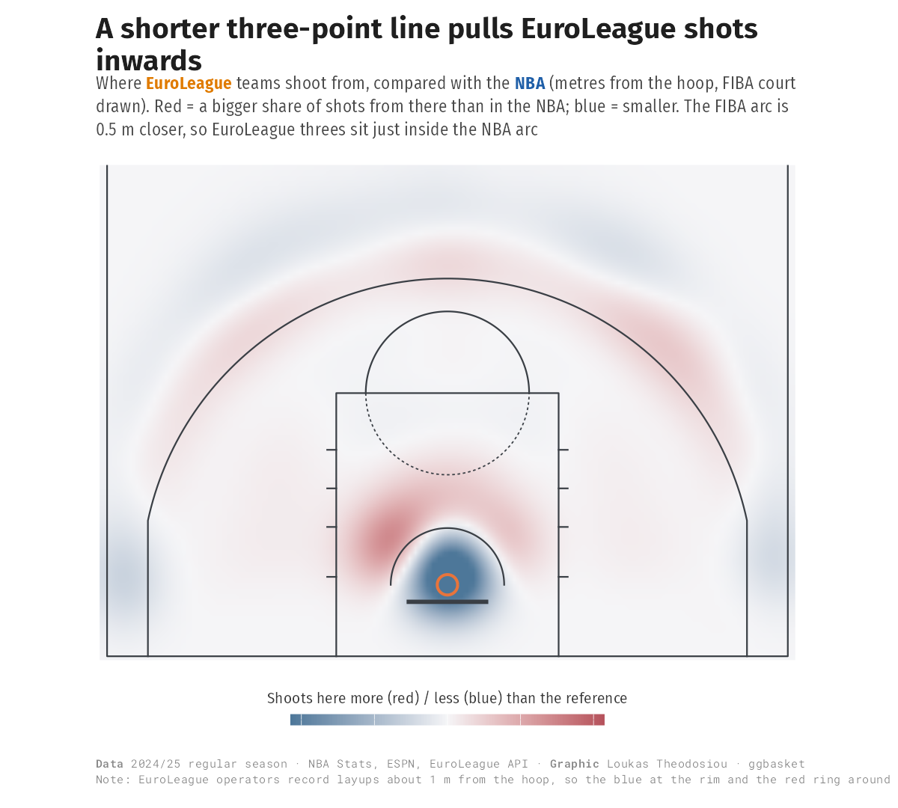 |
| **Team against team.** Olympiacos and Panathinaikos. `plot_shot_density()` | **Distance.** Expected points by distance, both leagues. `plot_shot_curve()` |
|  | 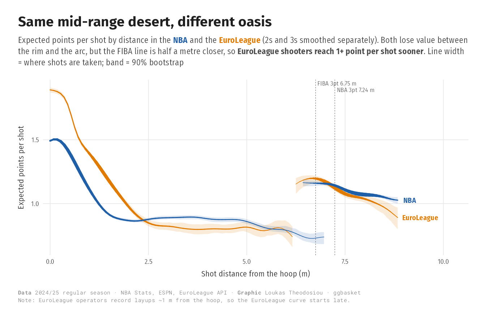 |
| **Shot-making.** Who beats the expected FG% of their shots. `plot_shot_making()` | **Play length.** Expected points by how long the play has run, OKC. `plot_shot_curve()` |
|  |  |

<details><summary><b>Code for these figures</b></summary>

```r
out(plot_shot_hex(subset(nba_sh, player %in% mvps), baseline = nba_sh, facet = "player",
                  title = "Four stars, four shot diets", caption = cap_now), "28_shot_hex", 10, 9)

out(plot_shot_zones(subset(nba_sh, player == "Nikola Jokic"), baseline = nba_sh,
                    title = "Nikola Jokic, 2024/25: elite from everywhere inside the arc", caption = cap_now), "29_shot_zones", 8, 6.5)
out(plot_shot_zones(subset(el_sh, player == "Sasha Vezenkov"), baseline = el_sh, league = "EuroLeague",
                    title = "Sasha Vezenkov, EuroLeague 2024/25 (FIBA court)", caption = cap_now), "30_shot_zones_el", 8, 6.5)

out(plot_shot_density(subset(nba_sh, player %in% c("Stephen Curry", "Giannis Antetokounmpo")), compare = nba_sh,
                      facet = "player", title = "Shot diet compared with the average NBA player",
                      caption = cap_now), "31_density", 11, 5.5)

el_stars <- c("Carsen Edwards", "Kendrick Nunn", "Mike James", "Sasha Vezenkov")
out(plot_shot_hex(subset(el_sh, player %in% el_stars), baseline = el_sh, facet = "player", league = "EuroLeague",
                  title = "Four EuroLeague scorers, four shot diets", caption = cap_now), "34_hex_el", 10, 9)
out(plot_shot_density(el_sh, compare = nba_sh, league = "EuroLeague",
                      title = "A shorter three-point line pulls EuroLeague shots inwards",
                      subtitle = paste("Where", colour_text("EuroLeague", "EuroLeague"), "teams shoot from, compared with the",
                                       colour_text("NBA", "NBA"), "(metres from the hoop, FIBA court drawn). Red = a bigger share of shots from there than in the NBA; blue = smaller. The FIBA arc is 0.5 m closer, so EuroLeague threes sit just inside the NBA arc"),
                      caption = paste(cap_now, "Note: EuroLeague operators record layups about 1 m from the hoop, so the blue at the rim and the red ring around it are partly a recording artefact.", sep = "<br>")),
    "35_density_leagues", 8, 7.2)
op <- subset(el_sh, team %in% c("OLY", "PAN"))
op$team <- c(OLY = "Olympiacos", PAN = "Panathinaikos")[op$team]
out(plot_shot_density(op, compare = el_sh, facet = "team", league = "EuroLeague",
                      title = "Olympiacos and Panathinaikos: two ways to attack",
                      subtitle = "Each team's shot locations compared with the average EuroLeague team, 2024/25 regular season. Red = shoots there more, blue = less",
                      caption = cap_now), "36_density_teams", 11, 5.6)
fin <- as_ggbasket_shots(filter(el_pbp, game_id == "E2024_330"), league = "EuroLeague")
fin$team <- c(ULK = "Fenerbahce", MCO = "Monaco")[fin$team]
out(plot_shot_density(fin, facet = "team", points = TRUE, league = "EuroLeague",
                      title = "The 2025 EuroLeague final, every shot",
                      subtitle = "Where each team shot from in the final (Fenerbahce 81, Monaco 70): heat = shot density, dots = made, crosses = missed",
                      caption = cap_el), "37_game_shots", 11, 5.8)

both <- shots_2024
both$dist <- sqrt(both$x^2 + both$y^2)
both <- subset(both, dist < 9)
sc <- shot_curve(both, "dist", by = "league", outcome = "points", n_boot = 100, bw = 0.25, split_value = TRUE)
out(plot_shot_curve(sc, vlines = c("FIBA 3pt 6.75 m" = 6.75, "NBA 3pt 7.24 m" = 7.24),
                    xlab = "Shot distance from the hoop (m)",
                    title = "Same mid-range desert, different oasis",
                    subtitle = paste("Expected points per shot by distance in the", colour_text("NBA", "NBA"), "and the", colour_text("EuroLeague", "EuroLeague"), "(2s and 3s smoothed separately). Both lose value between the rim and the arc, but the FIBA line is half a metre closer, so **EuroLeague shooters reach 1+ point per shot sooner**. Line width = where shots are taken; band = 90% bootstrap"),
                    caption = paste(cap_now, "Note: EuroLeague operators record layups ~1 m from the hoop, so the EuroLeague curve starts late.", sep = "<br>")),
    "32_curve_leagues", 9, 5.8)

okc_sh <- as_ggbasket_shots(filter(nba_reg, team == "OKC"))
pl4 <- c("Shai Gilgeous-Alexander", "Jalen Williams", "Chet Holmgren", "Luguentz Dort")
sc2 <- shot_curve(subset(okc_sh, player %in% pl4 & playlength <= 24), "playlength", by = "player",
                  outcome = "points", n_boot = 100, bw = 2)
out(plot_shot_curve(sc2, ref = mean(okc_sh$pts), ref_label = "OKC average",
                    xlab = "Seconds since the previous event (how long the play has run)",
                    title = "No OKC scorer is clearly better late in a play: the bands overlap",
                    subtitle = "Expected points per shot by how long the play has run, OKC 2024/25. Line width = how often each player shoots at that moment; band = 90% bootstrap",
                    caption = cap_nba), "32b_curve_playlength", 9, 5.5)

sm <- shot_making(expected_fg(shots_2024), prior_n = 150)
out(plot_shot_making(subset(sm, league == "NBA"), min_attempts = 500,
                     highlight = c("Stephen Curry", "Nikola Jokic", "Shai Gilgeous-Alexander"),
                     title = "Jokic, Curry and SGA make hard shots look easy",
                     subtitle = "NBA 2024/25. Each shot graded against a league model of make probability by location; players with 500+ attempts",
                     caption = cap_now), "33_shot_making", 9, 7)
```

</details>

### Teams

| | |
|---|---|
| **Where net rating comes from.** EuroLeague teams split into offence and defence. `plot_net_rating()` | **The same for the NBA.** OKC's defence was the league's best. `plot_net_rating()` |
| 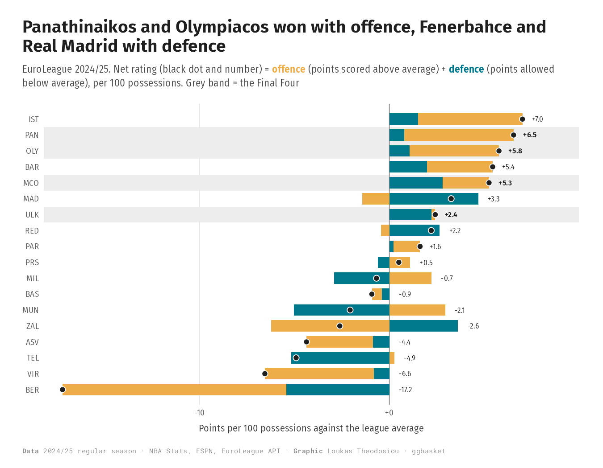 | 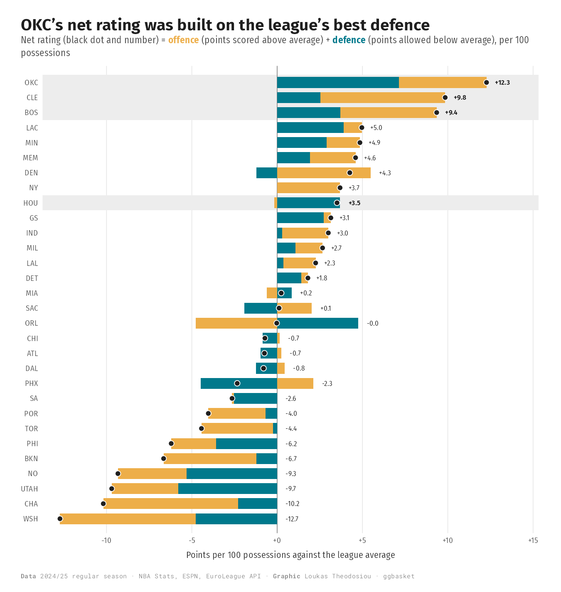 |
| **Offence against defence, EuroLeague.** Centred on the league average; corners say how a team wins. `plot_ratings()` | **Offence against defence, NBA.** `plot_ratings()` |
| 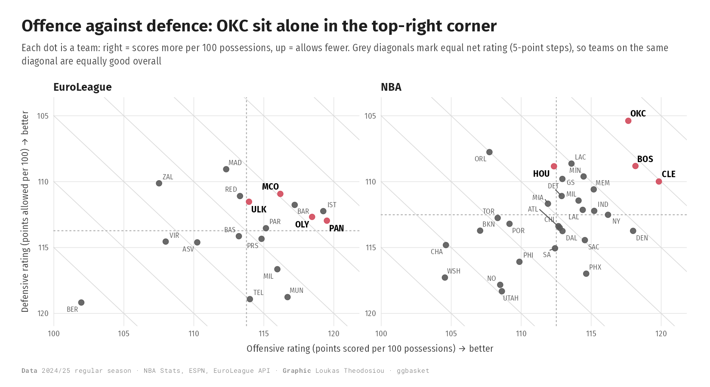 |  |
| **Four factors against the whole league.** Final Four teams on every team's spread. `plot_four_factors()` | |
|  | |
| **Four factors as a ranking table.** The 2025 EuroLeague Final Four. `plot_factor_ranks()` | **Schedule-adjusted ratings.** Simple Rating System with home advantage, both leagues. `team_ratings()`, `plot_team_ratings()` |
|  |  |
| **Transition.** How often teams run, and how well. `team_shot_profile()` + `plot_quadrant()` | **Shot quality.** Expected value of shots taken and allowed (EuroLeague). `team_shot_profile()` |
| 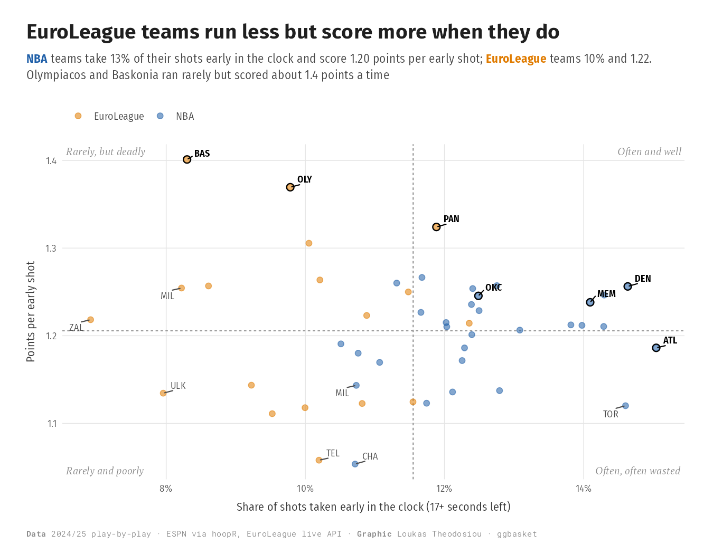 | 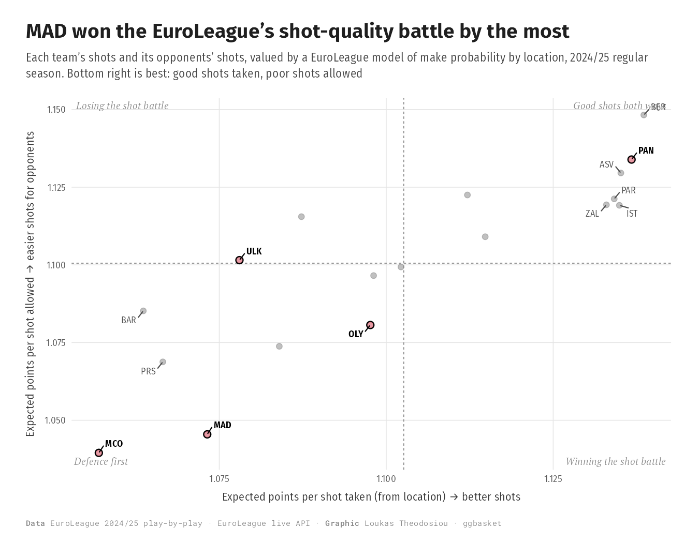 |
| **Luck.** Actual against Pythagorean wins. `plot_luck()` | **Scoring concentration.** Lorenz curves per team. `plot_lorenz()` |
|  |  |

<details><summary><b>Code for these figures</b></summary>

```r
el_ff <- subset(ff, league == "EuroLeague")
out(plot_net_rating(ff, "EuroLeague", highlight = c("OLY", "PAN", "ULK", "MCO"),
                    title = "Panathinaikos and Olympiacos won with offence, Fenerbahce and Real Madrid with defence",
                    subtitle = paste("EuroLeague 2024/25. Net rating (black dot and number) =", colour_text("offence", ggbasket_colours$offence),
                                     "(points scored above average) +", colour_text("defence", ggbasket_colours$defence),
                                     "(points allowed below average), per 100 possessions. Grey band = the Final Four"),
                    caption = cap_now), "13_ratings", 9, 7)
out(plot_net_rating(ff, "NBA", highlight = c("OKC", "CLE", "BOS", "HOU"),
                    title = "OKC's net rating was built on the league's best defence",
                    caption = cap_now), "13b_ratings_nba", 9, 9.5)
out(plot_ratings(subset(ff, league == "EuroLeague"), highlight = c("OLY", "PAN", "ULK", "MCO"),
                 title = "Panathinaikos and Olympiacos win with offence, Real Madrid and Fenerbahce with defence",
                 subtitle = "EuroLeague 2024/25. The centre is an average team; up and right are both better. Colour = net rating. Bold = the Final Four",
                 caption = cap_now), "13c_ratings_map", 9, 8.4)
out(plot_ratings(subset(ff, league == "NBA"), highlight = c("OKC", "CLE", "BOS", "HOU"),
                 title = "OKC's defence set them apart; Cleveland and Boston won mostly with offence",
                 subtitle = "NBA 2024/25. The centre is an average team; up and right are both better. Colour = net rating",
                 caption = cap_now), "13d_ratings_map_nba", 9, 8.4)

ff4 <- ff
nm <- c(OLY = "Olympiacos", PAN = "Panathinaikos", ULK = "Fenerbahce", MCO = "Monaco")
ff4$team[ff4$team %in% names(nm)] <- nm[ff4$team[ff4$team %in% names(nm)]]
out(plot_factor_ranks(ff4, unname(nm),
                      title = "Panathinaikos shot best, Fenerbahce defended best, Monaco looked after the ball, Olympiacos lived at the line",
                      caption = cap_now), "14_four_factors", 10, 7)
out(plot_four_factors(subset(ff, league == "EuroLeague"), teams = c("ULK", "PAN", "OLY", "MCO"),
                      title = "The same four factors against every EuroLeague team (grey)",
                      subtitle = "Standard deviations from the league average, right = better for the team. Offence = the team's own numbers, defence = what opponents managed against it",
                      caption = cap_now), "14b_four_factors_spread", 9, 9)

out(plot_luck(expected_wins(team_seasons), n = 6,
              title = "The Lakers won six more games than their point margin says",
              subtitle = paste("Open circle = wins expected from points scored and allowed; filled = actual wins.",
                               colour_text("Red", ggbasket_colours$above), "= luckier,",
                               colour_text("blue", ggbasket_colours$below), "= unluckier. Six luckiest and unluckiest per league"),
              caption = cap_now), "15_luck", 10, 6)

out(plot_lorenz(subset(player_seasons, league == "NBA"), "pts", "team", n = 8, value_label = "points",
                title = "Who depends on a few scorers?", caption = cap_now), "16_lorenz", 7.5, 7.5)
```

</details>

### Player impact

| | |
|---|---|
| **Adjusted plus-minus, NBA.** Ridge regression on every line-up stint. `rapm()`, `plot_rapm()` | **Adjusted plus-minus, EuroLeague.** `rapm()`, `plot_rapm()` |
|  | 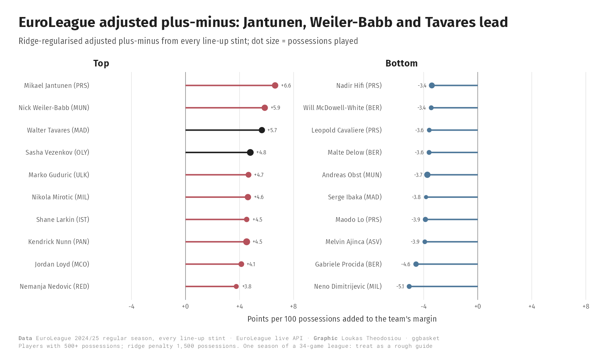 |
| **Win probability added.** Who moved Game 7, defence included. `win_probability_added()`, `plot_wpa()` | **Line-ups.** OKC's five-player units by net rating. `lineups()`, `plot_lineups()` |
|  | 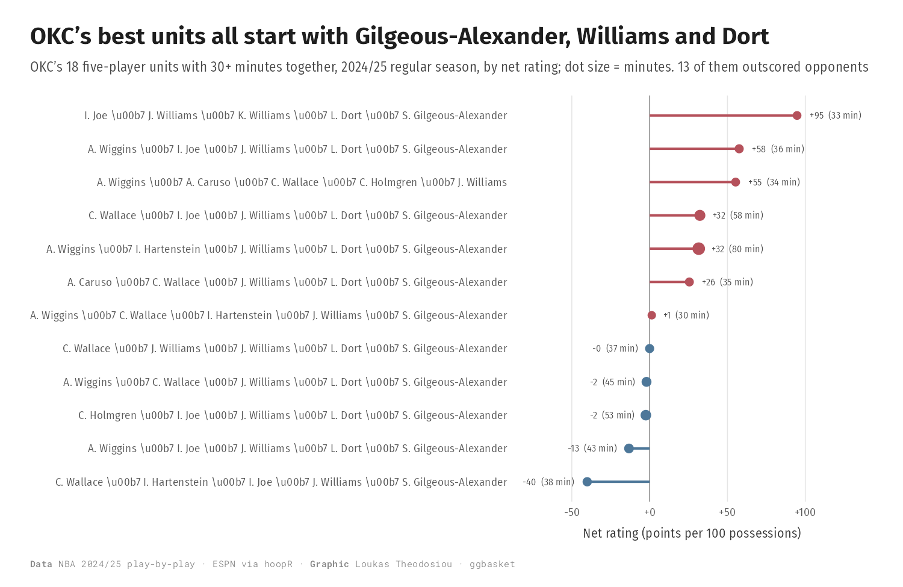 |

<details><summary><b>Code for these figures</b></summary>

```r
tr <- team_ratings(bind_rows(box_score(nba_reg, by = "team"), box_score(el_reg, by = "team")))
out(plot_team_ratings(tr, title = "Once the schedule is accounted for, OKC were 12.7 points better than an average team",
                      caption = cap_both), "38_team_ratings", 11, 9)
rp <- rapm(nba_reg, lambda = 3000, min_poss = 1000)
out(plot_rapm(rp, n = 12, highlight = c("Shai Gilgeous-Alexander", "Nikola Jokic"),
              title = "Separated from their team-mates, SGA and Jokic still add the most",
              caption = ggbasket_caption("NBA 2024/25 regular season, every line-up stint · ESPN via hoopR",
                                         note = "Players with 1,000+ possessions; ridge penalty 3,000 possessions")), "39_rapm", 11, 7)
rpe <- rapm(el_reg, lambda = 1500, min_poss = 500)
out(plot_rapm(rpe, n = 10, highlight = c("Sasha Vezenkov", "Walter Tavares"),
              title = "EuroLeague adjusted plus-minus: Jantunen, Weiler-Babb and Tavares lead",
              caption = ggbasket_caption("EuroLeague 2024/25 regular season, every line-up stint · EuroLeague live API",
                                         note = "Players with 500+ possessions; ridge penalty 1,500 possessions. One season of a 34-game league: treat as a rough guide")), "40_rapm_el", 11, 6.5)
wpa <- win_probability_added(win_probability(filter(nba_pbp, game_id == g7)))
out(plot_wpa(wpa, g7, colours = c(OKC = okc, IND = "#B8860B"),
             title = "Game 7: Gilgeous-Alexander's plays moved the needle most",
             caption = cap_nba), "41_wpa", 9, 6)
lu <- lineups(nba_reg, team = "OKC", min_minutes = 30)
out(plot_lineups(lu, n = 6, title = "OKC's best units all start with Gilgeous-Alexander, Williams and Dort",
                 subtitle = sprintf("OKC's %d five-player units with 30+ minutes together, 2024/25 regular season, by net rating; dot size = minutes. %d of them outscored opponents",
                                    nrow(lu), sum(lu$net > 0)),
                 caption = cap_nba), "42_lineups", 10, 6.5)
ps_all <- bind_rows(expected_fg(pressure_situations(nba_reg, "NBA", 14)), expected_fg(pressure_situations(el_reg, "EuroLeague", 14)))
tp <- team_shot_profile(ps_all)
lg <- tp |> group_by(league) |> summarise(s = weighted.mean(early_share, fga), p = weighted.mean(pps_early, fga * early_share))
out(plot_quadrant(tp, "early_share", "pps_early", label = "team", colour = "league", highlight = c("ATL", "DEN", "MEM", "OKC", "OLY", "PAN", "BAS"),
                  corners = c("Rarely, but deadly", "Often and well", "Rarely and poorly", "Often, often wasted"),
                  xlab = "Share of shots taken early in the clock (17+ seconds left)", ylab = "Points per early shot",
                  title = "EuroLeague teams run less but score more when they do",
                  subtitle = sprintf("%s teams take %.0f%% of their shots early in the clock and score %.2f points per early shot; %s teams %.0f%% and %.2f. Olympiacos and Baskonia ran rarely but scored about 1.4 points a time",
                                     colour_text("NBA", "NBA"), 100 * lg$s[lg$league == "NBA"], lg$p[lg$league == "NBA"],
                                     colour_text("EuroLeague", "EuroLeague"), 100 * lg$s[lg$league == "EuroLeague"], lg$p[lg$league == "EuroLeague"]),
                  caption = cap_both) + ggplot2::scale_x_continuous(labels = scales::label_percent()), "43_transition", 9, 7)
tpe <- subset(tp, league == "EuroLeague"); tpe$net <- tpe$xpps - tpe$o_xpps
best <- tpe$team[which.max(tpe$net)]
out(plot_quadrant(tpe, "xpps", "o_xpps", label = "team", highlight = c(best, "OLY", "PAN", "ULK", "MCO"),
                  corners = c("Losing the shot battle", "Good shots both ways", "Defence first", "Winning the shot battle"),
                  xlab = "Expected points per shot taken (from location) \u2192 better shots", ylab = "Expected points per shot allowed \u2192 easier shots for opponents",
                  title = sprintf("%s won the EuroLeague's shot-quality battle by the most", best),
                  subtitle = "Each team's shots and its opponents' shots, valued by a EuroLeague model of make probability by location, 2024/25 regular season. Bottom right is best: good shots taken, poor shots allowed",
                  caption = cap_el), "44_shot_quality", 9, 7)
```

</details>

### Players

| | |
|---|---|
| **Fingerprints.** Percentiles on nine stats. `plot_profile()` | **The same fingerprints as radars.** `plot_profile(style = "radar")` |
| 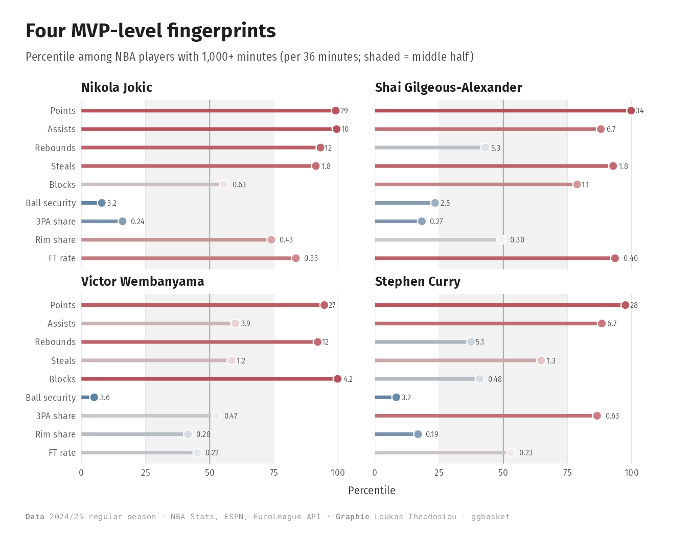 |  |
| **Quadrants.** Assists against turnovers. `plot_quadrant()` | **Joint density.** Usage against efficiency. `plot_joint()` |
|  |  |
| **Above or below the line.** Turnovers for the assist load. `plot_fit()` | **Spread within a team.** OKC's shooting. `plot_spread()` |
|  | 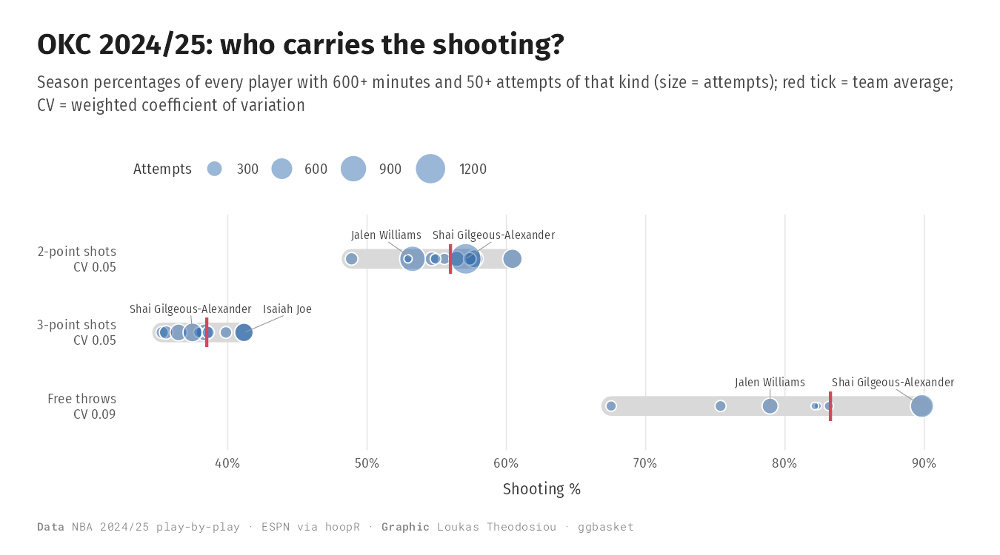 |
| **Ranked bars.** OKC's shot diet by plus-minus. `plot_ranked()` | **Correlations.** What goes together in a stat line. `plot_corr_matrix()` |
| 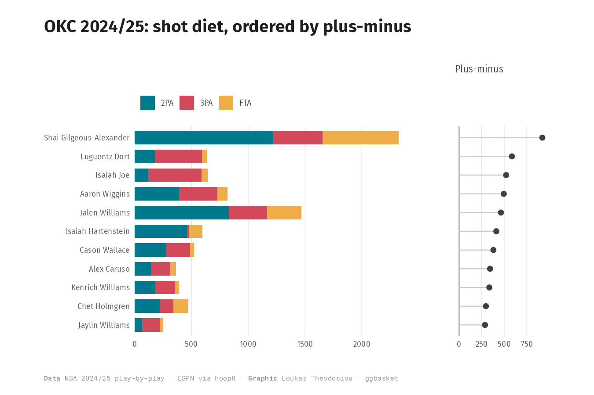 | 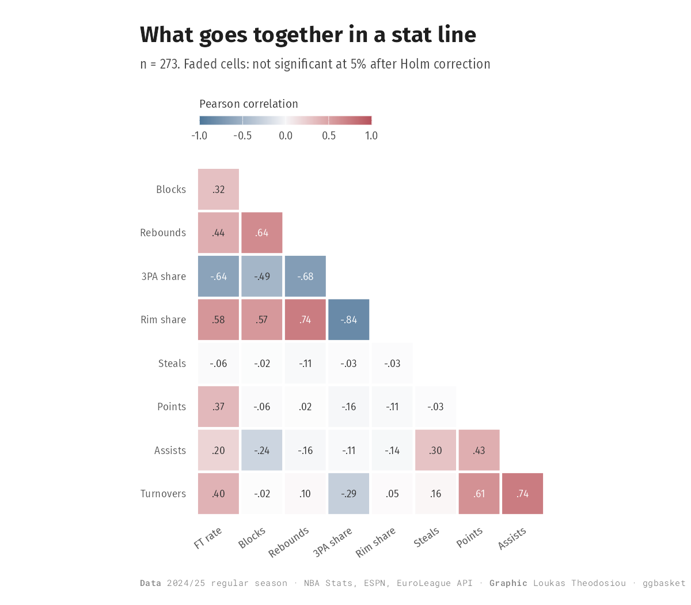 |
| **Similarity map.** The NBA in two dimensions. `plot_similarity_map()` | **How many player types?** `plot_cluster_quality()` |
|  | 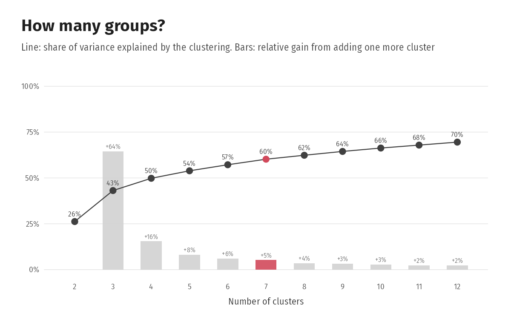 |
| **Seven kinds of player.** `plot_cluster_profiles()` | |
|  | |

<details><summary><b>Code for these figures</b></summary>

```r
pl <- subset(player_seasons, minutes >= 1000)
pl <- transform(pl, pts36 = 36 * pts / minutes, ast36 = 36 * ast / minutes, reb36 = 36 * (orb + drb) / minutes,
                stl36 = 36 * stl / minutes, blk36 = 36 * blk / minutes, tov36 = 36 * tov / minutes,
                three_rate = p3a / (p2a + p3a), rim_rate = rim / (p2a + p3a), ft_rate = fta / (p2a + p3a))
stat_vars <- c(Points = "pts36", Assists = "ast36", Rebounds = "reb36", Steals = "stl36", Blocks = "blk36",
               Turnovers = "tov36", `3PA share` = "three_rate", `Rim share` = "rim_rate", `FT rate` = "ft_rate")
prof_vars <- c(Points = "pts36", Assists = "ast36", Rebounds = "reb36", Steals = "stl36", Blocks = "blk36",
               `Ball security` = "tov36", `3PA share` = "three_rate", `Rim share` = "rim_rate", `FT rate` = "ft_rate")
mvps <- c("Nikola Jokic", "Shai Gilgeous-Alexander", "Victor Wembanyama", "Stephen Curry")

nba <- subset(pl, league == "NBA")
out(plot_profile(nba, "player", prof_vars, reverse = "tov36", subjects = mvps, ncol = 2,
                 title = "Four MVP-level fingerprints",
                 subtitle = "Percentile among NBA players with 1,000+ minutes (per 36 minutes; shaded = middle half)",
                 caption = cap_now), "17_profile", 9, 7)
out(plot_profile(nba, "player", prof_vars, reverse = "tov36", style = "radar", subjects = mvps, ncol = 4,
                 title = "The same fingerprints as radars, on percentiles", caption = cap_now), "18_profile_radar", 13, 4.2)

out(plot_quadrant(subset(pl, minutes >= 1500), "ast36", "tov36", label = "player", colour = "league",
                  size = "pts36", highlight = c("Nikola Jokic", "Trae Young", "Kendrick Nunn", "Facundo Campazzo", "Tyrese Haliburton"),
                  corners = c("Turnover-prone", "High-load creators", "Off-ball roles", "Careful creators"),
                  xlab = "Assists per 36 minutes", ylab = "Turnovers per 36 minutes", size_lab = "Points per 36",
                  title = "Creating costs turnovers - but not equally", caption = cap_now), "19_quadrant", 9, 7)

pr <- subset(player_rates(player_seasons, team_seasons), league == "NBA" & minutes >= 1500)
out(plot_joint(pr, "usg_pct", "ts_pct", label = "player",
               highlight = c("Shai Gilgeous-Alexander", "Nikola Jokic", "Giannis Antetokounmpo", "Stephen Curry",
                             "Victor Wembanyama", "Anthony Edwards", "Luka Doncic", "Jayson Tatum"),
               xlab = "Usage rate (share of team plays used on the floor) →",
               ylab = "True shooting % →", x_labels = scales::label_percent(), y_labels = scales::label_percent(),
               title = "Stars bend the usage–efficiency curve",
               subtitle = "Most NBA players with 1,500+ minutes sit in the purple cloud. The stars use a third of their team's plays and still score efficiently",
               caption = cap_now), "20_joint", 9, 8)

out(plot_fit(subset(pl, league == "NBA"), "ast36", "tov36", label = "player", above_is_good = FALSE,
             xlab = "Assists per 36", ylab = "Turnovers per 36",
             title = "For their assist load, who protects the ball?", caption = cap_now), "21_fit", 9, 6.5)

okc_box <- subset(box_score(nba_reg, total = TRUE), team == "OKC" & min >= 600)

out(plot_spread(okc_box, c("p2m", "p3m", "ftm"), c("p2a", "p3a", "fta"),
                labels = c("2-point shots", "3-point shots", "Free throws"), shrink = FALSE, min_attempts = 50, label_top = 2,
                title = "OKC 2024/25: who carries the shooting?",
                subtitle = "Season percentages of every player with 600+ minutes and 50+ attempts of that kind (size = attempts); red tick = team average; CV = weighted coefficient of variation",
                caption = cap_nba), "22_spread", 9, 5)

out(plot_ranked(okc_box, "player", c(`2PA` = "p2a", `3PA` = "p3a", FTA = "fta"), line = "pm",
                order_by = "pm", line_label = "Plus-minus",
                title = "OKC 2024/25: shot diet, ordered by plus-minus", caption = cap_nba), "23_ranked", 9, 6)

out(plot_corr_matrix(pl, c(Points = "pts36", Assists = "ast36", Turnovers = "tov36", Rebounds = "reb36",
                           Blocks = "blk36", Steals = "stl36", `3PA share` = "three_rate",
                           `Rim share` = "rim_rate", `FT rate` = "ft_rate"),
                     title = "What goes together in a stat line", caption = cap_now), "24_corr", 8, 7)

big <- subset(pl, league == "NBA" & minutes >= 1500)
out(plot_similarity_map(big, stat_vars, label = "player", colour = "position",
                        highlight = c("Nikola Jokic", "Victor Wembanyama", "Stephen Curry"),
                        title = "The NBA in two dimensions", caption = cap_now), "25_map", 10, 8)

big <- subset(pl, league == "NBA" & minutes >= 1500)
cq <- cluster_quality(big, unname(stat_vars), k = 2:12)
out(plot_cluster_quality(cq, choose = 7), "26_cluster_quality", 8, 5)
set.seed(1); km <- kmeans(scale(big[, unname(stat_vars)]), 7, nstart = 50)
out(plot_cluster_profiles(big, stat_vars, km$cluster, label = "player",
                          title = "Seven kinds of NBA player", caption = cap_now), "27_cluster_profiles", 11, 7)
```

</details>

## Data

* **Play-by-play**: `pbp_from_espn()` (NBA via hoopR), `pbp_from_euroleague()` / `fetch_euroleague_pbp()`
  (EuroLeague live API, shot locations joined in). Both give the same layout, documented in `?pbp`; the
  players on court are rebuilt from substitutions by `add_lineups()`. BasketballAnalyzeR's `PbP` also works,
  and `as_ggbasket_teams()`, `as_ggbasket_players()`, `as_ggbasket_shots()` convert its other tables.
* **Bundled**: `pbp_games` (2025 NBA Finals Game 7 and the 2025 EuroLeague final), `team_seasons`,
  `player_seasons`, `shots_2024` (2024/25 regular seasons). `data-raw/make_pbp.R` builds the two full
  seasons (1,321 NBA and 330 EuroLeague games).
* **Conventions**: lower-case box-score columns (`pts p2m p2a p3m p3a ftm fta orb drb ast tov stl blk pf`),
  opponent columns prefixed `o_`, shot `x`, `y` in metres from the hoop centre (y towards half court).

## Tested on real games

On the 2024/25 seasons:

* **NBA box scores are reproduced from play-by-play.** Season points, assists, rebounds, steals, blocks and
  turnovers match the official totals exactly. Every team-game adds up to 240 minutes. Game 7 gives
  OKC 103-91, SGA 29 points and 12 assists, and Indiana 23 turnovers.
* **EuroLeague** final scores match the API for all 330 games. 658 of 660 team-games add up to exactly
  200 minutes. Assists match once FIBA's free-throw assists are counted.
* **Win probability** is a two-parameter score model (Stern, 1994). Its spread is fitted by likelihood on
  every in-game situation. Held-out NBA games are calibrated to within about 5 percentage points. Home
  advantage is worth 3.3 points per game in the EuroLeague and 1.6 in the NBA.
* **Pressure**: with 2 seconds or less on the shot clock, shots go in about 7.5 percentage points less often
  in the NBA and 7.4 in the EuroLeague, after accounting for location. The score and hot or cold
  streaks make no measurable difference.

`R CMD check` passes, and the tests run on the bundled finals.

## Style

`theme_ggbasket()` follows Cedric Scherer's editorial look:

* a plain white background; colours from the `heatmap1` and `minou` palettes of [ltc](https://github.com/loukesio/ltc-color-palettes); and a "painted" court (cool-grey floor, blue-grey key, orange rim; `geom_court(style = )` also offers `"arena"` and `"minimal"`);
* a bold title that states the finding;
* a markdown subtitle that names groups in their own colour (`colour_text()`) instead of a legend;
* a monospaced "Data · Graphic" caption.

Fonts are Fira Sans, Fira Sans Condensed and Roboto Mono, all free on Google Fonts; if they are missing, the
system sans is used. Use `ggsave(..., device = cairo_pdf)` or PNG for the full look.

## Origins

ggbasket began as a redesign of the analyses in Zuccolotto & Manisera, *Basketball Data Science* (CRC 2020).
[`BOOK_REVIEW.md`](BOOK_REVIEW.md) holds that chapter-by-chapter critique and the book's figures next to
their ggbasket counterparts.

## Licence

Copyright (c) 2026 Loukas Theodosiou. All rights reserved. ggbasket is proprietary software: you may look at
it here, but you may not install, run, copy, modify or redistribute it without written permission. Reports
made with it may be shared by their recipients for internal use, with attribution. See [LICENSE](LICENSE). For
licences, contact loukesio@gmail.com. Versions before 0.6.0 were released under the MIT licence.
