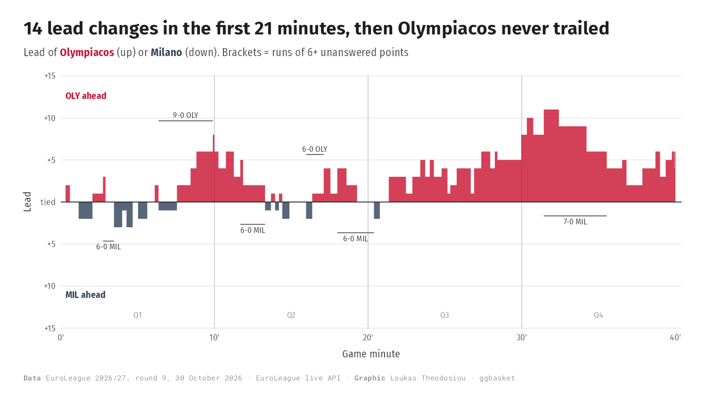
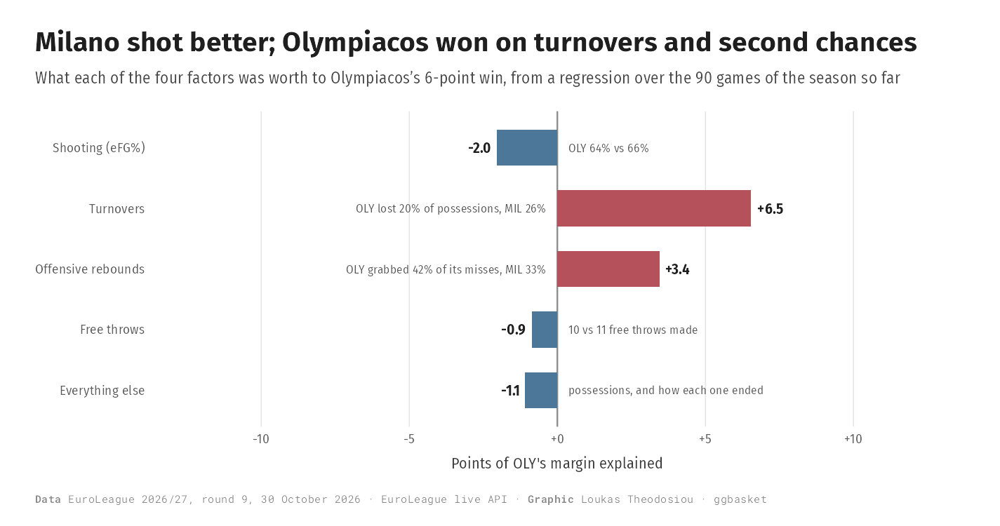
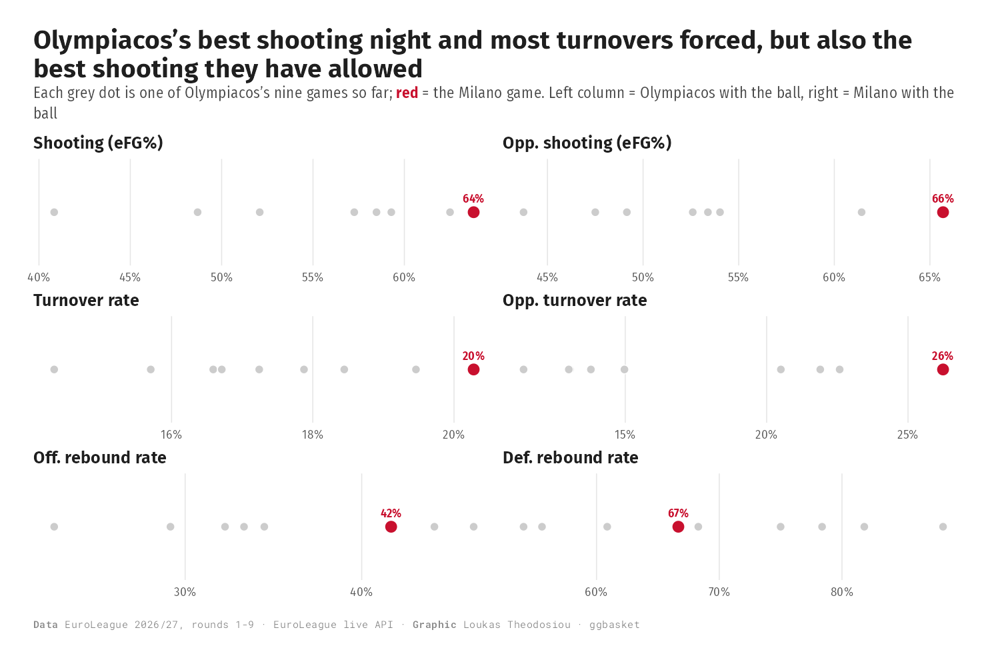
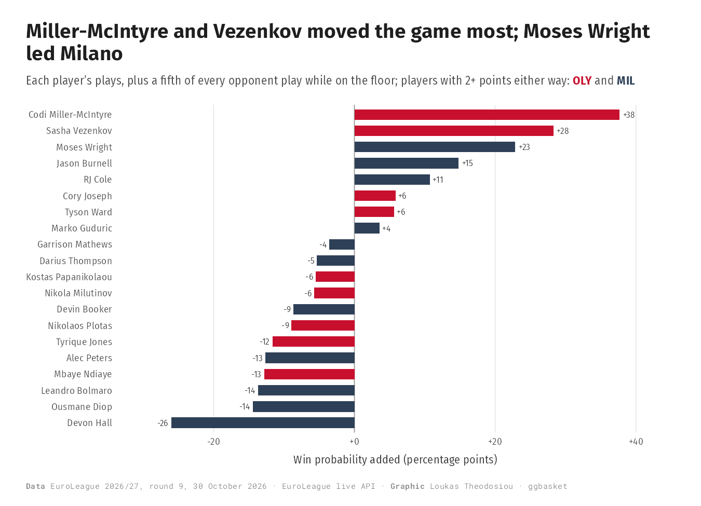
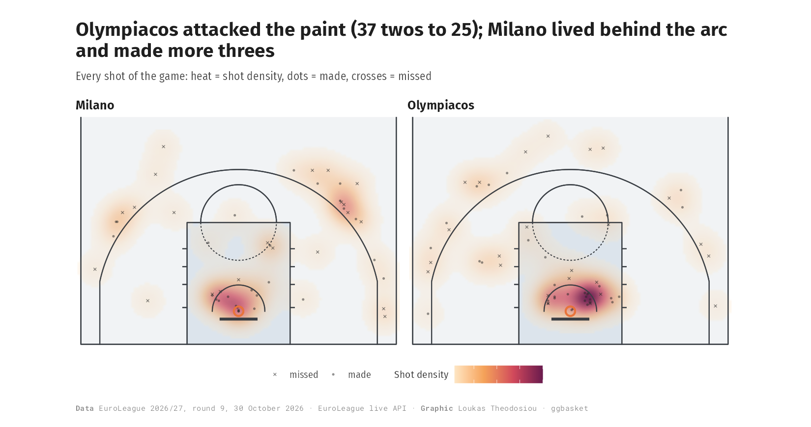
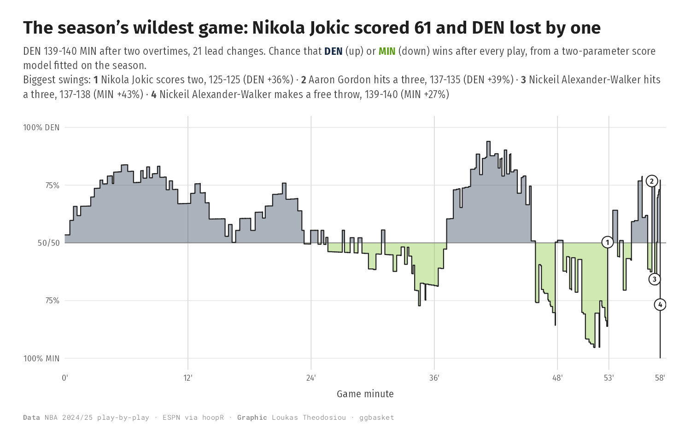
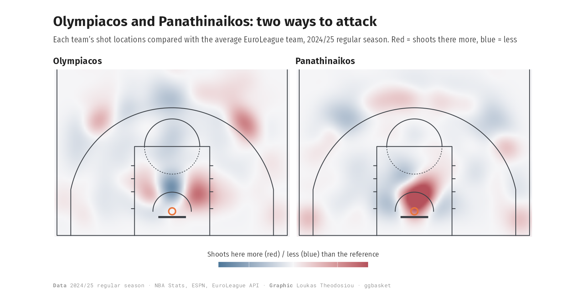
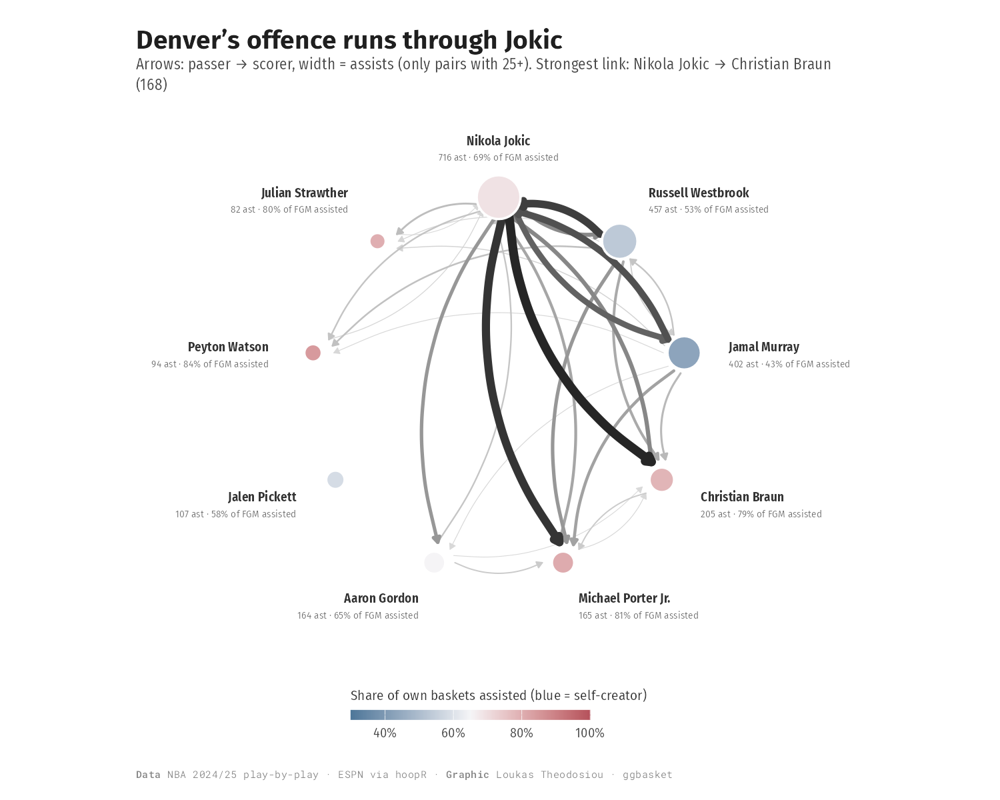
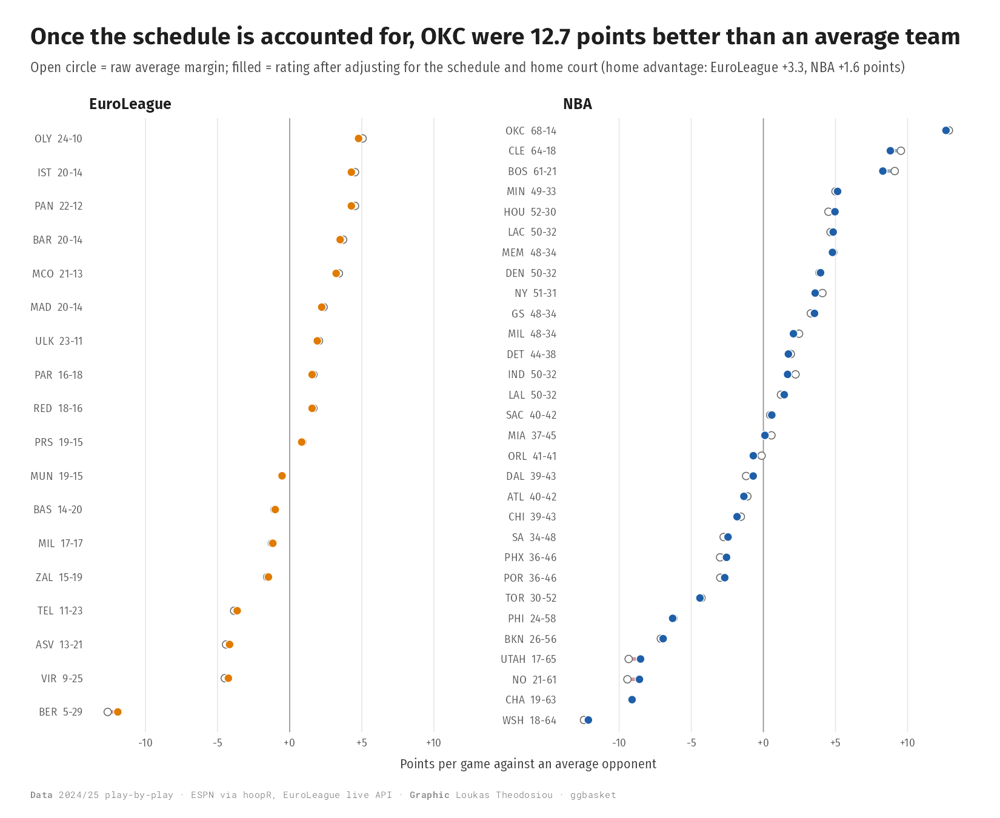
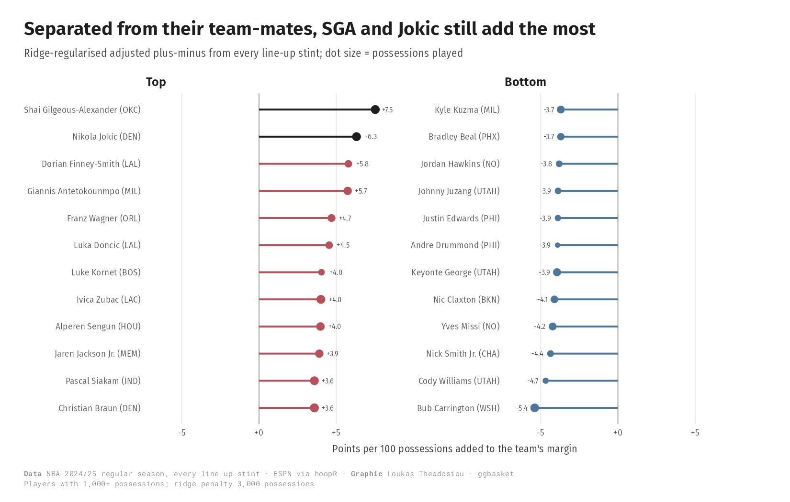

# ggbasket


**Learn from basketball games, NBA and EuroLeague.** ggbasket reads play-by-play, box-score and shot data
from both leagues into one layout, computes the measures analysts use (win probability, on/off, four
factors, shot quality, pressure) and draws each answer as a finished, story-first ggplot2 figure.

```r
devtools::install_github("loukesio/ggbasket")
library(ggbasket)

# one game: the 2025 NBA Finals Game 7 is bundled
plot_game_flow(pbp_games, "401766128")
plot_win_probability(win_probability(pbp_games), "401766128")
box_score(pbp_games)                        # player box score with minutes and plus-minus

# a whole season, either league
nba <- pbp_from_espn(hoopR::load_nba_pbp(seasons = 2025))   # ESPN, via hoopR
el  <- fetch_euroleague_pbp(season = 2024)                  # official EuroLeague API, with shot locations
on_off(el, team = "PAN")
```

## Creating a match report

A report holds:
* the key findings in words;
* the game flow;
* win probability, with the plays that swung it;
* what decided the result, and who mattered;
* every shot;
* box scores, clutch time and line-ups.

It is one self-contained HTML file with the figures inside, ready to e-mail or post. Examples:
[Olympiacos 84-78 Olimpia Milano](https://loukesio.github.io/ggbasket/reports/OLY-MIL-2026-10-30.html) and
[Oklahoma City 103-91 Indiana, 2025 NBA Finals Game 7](https://loukesio.github.io/ggbasket/reports/OKC-IND-2025-06-22.html).

**1. Find the game.**

```r
library(ggbasket)

# EuroLeague: every played game of the season, with its game code
euroleague_games(2026, team = "OLY")      # 2026 = the 2026/27 season
#>   game date       round home away home_name          away_name            home_score away_score
#>     90 2026-10-30     9 OLY  MIL  Olympiacos Piraeus Armani Olimpia Milan         84         78

# NBA: the games on a date, with ESPN's game id
nba_games("2025-06-22")
#>   game      date       home away home_name             away_name      home_score away_score
#>   401766128 2025-06-22 OKC  IND  Oklahoma City Thunder Indiana Pacers        103         91
```

**2. Make the report.** This takes about 10 seconds. The file is saved in your working directory as
`<home>-<away>-<date>.html` and opens in your browser.

```r
match_report(90, "EuroLeague", season = 2026)
match_report("401766128", "NBA")
```

**3. Optional extras.**

```r
match_report(90, "EuroLeague", season = 2026,
             context = TRUE,                                   # compare with both teams' season (about a minute)
             names   = c(OLY = "Olympiacos", MIL = "Milano"),  # shorter display names
             colours = c("#C8102E", "#2E4057"),                # team colours, home first
             file    = "reports/olympiacos-milano.html")       # where to save it
```

**4. Share it.** Send the HTML file as an attachment, put it on a shared drive, or publish it on a website. It
needs no R and no internet connection to open. For a quick message, `match_story()` gives the key findings as
text:

```r
match_story(fetch_game(90, "EuroLeague", season = 2026))
#> "**Olympiacos Piraeus beat Armani Olimpia Milan by 6** (84-78). There were 14 lead changes and 9 ties ..."
#> "**What decided it: turnovers.** It was worth about +5.9 points to Olympiacos Piraeus (18 turnovers against 14) ..."
```

**5. Report on several games at once.** Every game of Olympiacos's season so far:

```r
games <- euroleague_games(2026, team = "OLY")
for (g in games$game) match_report(g, "EuroLeague", season = 2026, open = FALSE)
```

## Case study: what can we learn from one game?

**Olympiacos 84-78 Olimpia Milano**, EuroLeague round 9, 30 October 2026. Everything below comes from
the game's play-by-play, downloaded with one call, and is redrawn by `Rscript gallery/make_case.R`.

```r
el <- fetch_euroleague_pbp(2026)            # the season so far, with shot locations
gm <- subset(el, game_id == "E2026_90")
```

**1. How did the game unfold?** The first half was a coin toss: 14 lead changes and 9 ties, with five runs
of six or more unanswered points. Milano led for the last time in the 21st minute. Olympiacos's biggest
run was 9-0 and their biggest lead 11; Milano never led by more than 3.



```r
game_summary(gm)                      # lead changes, ties, biggest leads, best run
scoring_runs(gm, min_points = 6)
plot_game_flow(gm, min_run = 6, colours = c("#C8102E", "#2E4057"))
```

**2. Which plays decided it?** Olympiacos were favourites from the third quarter on, up to 95% when they led
by 11. Milano's 7-0 run early in the fourth made it close again, and the biggest swings all came late:
* Jason Burnell's three made it 75-73 and took 18 points off Olympiacos's chances.
* Cory Joseph answered with a basket for 77-73 (+15).
* Leandro Bolmaro's three at 79-76 was Milano's last push.


```r
wp <- win_probability(gm)
plot_win_probability(wp, n_key = 4, colours = c("#C8102E", "#2E4057"))
```

**3. Why did Olympiacos win?** Not by shooting: Milano's effective field-goal percentage was higher
(66% against 64%). The margin came from possessions.
* **Turnovers:** Milano lost the ball 18 times against Olympiacos's 14 (26% of possessions against 20%),
  worth about +6.5 points.
* **Offensive rebounds:** Olympiacos grabbed 42% of their own misses against Milano's 33%, worth +3.4.
* **Free throws:** almost level (10 made against 11).



```r
gf <- game_factors(box_score(el, by = "team"))   # fitted on the season; one game alone also works
plot_game_factors(gf, "E2026_90", team = "OLY")
```

**4. Was this a typical Olympiacos game?** No. Against their eight other games so far:
* It was their best shooting night (64% eFG) and the most turnovers they have forced (26%).
* It was also the best shooting they have allowed (66%), so the defence won the ball back rather than
  contesting shots.



```r
oly <- four_factors(box_score(subset(el, hometeam == "OLY" | awayteam == "OLY"), by = "team"))
subset(oly, team == "OLY")[, c("game_id", "efg", "tov_pct", "orb_pct", "o_efg", "o_tov_pct", "drb_pct")]
```

**5. Who made the difference?** Codi Miller-McIntyre (24 points, 4 of 9 threes, +18 on the floor) and
Sasha Vezenkov (23 points, 8 of 10 twos) moved Olympiacos's win probability the most. Win probability added
counts a player's own plays and a fifth of every opponent play while they were on the floor. For Milano,
Moses Wright and Burnell added the most; RJ Cole scored 17 but was −10 on the floor.



```r
wpa <- win_probability_added(wp)
plot_wpa(wpa, colours = c(OLY = "#C8102E", MIL = "#2E4057"))
box_score(gm)                          # points, shooting, plus-minus for every player
```

**6. Where did the shots come from?** Olympiacos attacked the paint: 37 twos at 68%, against Milano's 25.
Milano lived behind the arc and made more threes: 11 of 26 (42%), against Olympiacos's 8 of 21 (38%).



```r
sh <- as_ggbasket_shots(gm, league = "EuroLeague")
plot_shot_density(sh, facet = "team", points = TRUE, league = "EuroLeague")
```

**7. Who did Olympiacos play best with?** In this game, Olympiacos were best with Miller-McIntyre on the
floor. Over the nine games so far, Vezenkov is the steadiest player (median Game Score 15.5), and the team
is +21 per 100 possessions with Jean Montero on the floor against +2 without him. These are small
early-season samples, worth watching rather than concluding from.

| | |
|---|---|
|  |  |


```r
plot_on_off(on_off(gm, team = "OLY", min_minutes = 8))
ob <- game_score(box_score(subset(el, hometeam == "OLY" | awayteam == "OLY")))
plot_consistency(subset(ob, team == "OLY"), players = c("Sasha Vezenkov", "Jean Montero", "Tyson Ward"))
plot_on_off(on_off(subset(el, hometeam == "OLY" | awayteam == "OLY"), team = "OLY", min_minutes = 60))
```

**In one sentence:** Milano shot better, but Olympiacos won the possession battle. Four more turnovers forced
and three more offensive rebounds were worth about 10 points. Miller-McIntyre and Vezenkov turned those chances into points, and
Cory Joseph's basket at 77-73 settled a game that was level for its first 21 minutes.

## What you can learn from a game

| Question | Functions |
|---|---|
| How did the game unfold? Who made the runs? | `game_flow()`, `scoring_runs()`, `plot_game_flow()` |
| Which plays decided it? | `win_probability()`, `plot_win_probability()` |
| Why did the winner win: shooting, turnovers, rebounds or free throws? | `game_factors()`, `plot_game_factors()` |
| Was it a classic? | `game_summary()`: lead changes, biggest leads, best run, excitement, comeback |
| Who played well? | `box_score()`, `game_score()`, `win_probability_added()` |
| Everything at once, to share | `euroleague_games()`, `nba_games()`, `match_report()`, `match_story()`, `fetch_game()` |

## What you can learn from many games

| Question | Functions |
|---|---|
| Is the team better with this player on the floor? Which line-ups work? | `stints()`, `on_off()`, `lineups()`, `plot_on_off()` |
| Who can you count on every night? | `game_score()`, `plot_consistency()` |
| Who performs when it is close? | `clutch_time()` + any other function |
| Who creates for whom? | `assist_network()`, `plot_assist_network()`, `plot_assist_matrix()`, `plot_assist_roles()` |
| Does pressure (shot clock, score, streaks, end of period) change shooting? | `pressure_situations()`, `pressure_effects()`, `plot_pressure()` |
| How does a shot's value change with distance or shot clock? | `shot_curve()`, `plot_shot_curve()` |

## Teams, players and shots

| Topic | Metrics | Plots |
|---|---|---|
| Teams | `possessions()`, `four_factors()`, `team_ratings()`, `team_shot_profile()`, `expected_wins()`, `gini()`, `lorenz()` | `plot_net_rating()`, `plot_factor_ranks()`, `plot_team_ratings()`, `plot_luck()`, `plot_lorenz()`, `plot_ratings()`, `plot_four_factors()` |
| Player impact | `rapm()`, `win_probability_added()`, `on_off()`, `lineups()` | `plot_rapm()`, `plot_wpa()`, `plot_on_off()`, `plot_lineups()` |
| Players | `player_rates()` (TS%, usage, AST%, rebound, steal, block and turnover rates), `percentile_rank()`, `shrink_rate()` | `plot_profile()`, `plot_quadrant()`, `plot_joint()`, `plot_fit()`, `plot_spread()`, `plot_ranked()` |
| Shots | `shot_zone()`, `summarise_zones()`, `bin_shots_hex()`, `expected_fg()`, `shot_making()` | `plot_shot_hex()`, `plot_shot_zones()`, `plot_shot_density()`, `plot_shot_making()` |
| Patterns | `association()`, `cluster_quality()` | `plot_association()`, `plot_corr_matrix()`, `plot_similarity_map()`, `plot_cluster_quality()`, `plot_cluster_profiles()` |
| Courts and style | `court_spec()`, `court_lines()`, `ggbasket_fonts()` | `geom_court()` (NBA and FIBA), `theme_ggbasket()`, `theme_court()`, `colour_text()`, `ggbasket_caption()` |

## Gallery

ggbasket draws 49 figures from real 2024/25 NBA and EuroLeague data, each with its code. **[Open the gallery
&rarr;](https://loukesio.github.io/ggbasket/articles/gallery.html)**

| | | |
|---|---|---|
| [](https://loukesio.github.io/ggbasket/articles/gallery.html#one-game) | [](https://loukesio.github.io/ggbasket/articles/gallery.html#one-game) | [](https://loukesio.github.io/ggbasket/articles/gallery.html#shots-on-the-court) |
| [](https://loukesio.github.io/ggbasket/articles/gallery.html#a-season-of-games) | [](https://loukesio.github.io/ggbasket/articles/gallery.html#teams) | [](https://loukesio.github.io/ggbasket/articles/gallery.html#player-impact) |

## Data

* **Play-by-play**: `pbp_from_espn()` (NBA via hoopR), `pbp_from_euroleague()` / `fetch_euroleague_pbp()`
  (EuroLeague live API, shot locations joined in). Both give the same layout, documented in `?pbp`; the
  players on court are rebuilt from substitutions by `add_lineups()`. BasketballAnalyzeR's `PbP` also works,
  and `as_ggbasket_teams()`, `as_ggbasket_players()`, `as_ggbasket_shots()` convert its other tables.
* **Bundled**: `pbp_games` (2025 NBA Finals Game 7 and the 2025 EuroLeague final), `team_seasons`,
  `player_seasons`, `shots_2024` (2024/25 regular seasons). `data-raw/make_pbp.R` builds the two full
  seasons (1,321 NBA and 330 EuroLeague games).
* **Conventions**: lower-case box-score columns (`pts p2m p2a p3m p3a ftm fta orb drb ast tov stl blk pf`),
  opponent columns prefixed `o_`, shot `x`, `y` in metres from the hoop centre (y towards half court).

## Tested on real games

On the 2024/25 seasons:

* **NBA box scores are reproduced from play-by-play.** Season points, assists, rebounds, steals, blocks and
  turnovers match the official totals exactly. Every team-game adds up to 240 minutes. Game 7 gives
  OKC 103-91, SGA 29 points and 12 assists, and Indiana 23 turnovers.
* **EuroLeague** final scores match the API for all 330 games. 658 of 660 team-games add up to exactly
  200 minutes. Assists match once FIBA's free-throw assists are counted.
* **Win probability** is a two-parameter score model (Stern, 1994). Its spread is fitted by likelihood on
  every in-game situation. Held-out NBA games are calibrated to within about 5 percentage points. Home
  advantage is worth 3.3 points per game in the EuroLeague and 1.6 in the NBA.
* **Pressure**: with 2 seconds or less on the shot clock, shots go in about 7.5 percentage points less often
  in the NBA and 7.4 in the EuroLeague, after accounting for location. The score and hot or cold
  streaks make no measurable difference.

`R CMD check` passes, and the tests run on the bundled finals.

## Style

`theme_ggbasket()` follows Cedric Scherer's editorial look:

* a plain white background; colours from the `heatmap1` and `minou` palettes of [ltc](https://github.com/loukesio/ltc-color-palettes); and a "painted" court (cool-grey floor, blue-grey key, orange rim; `geom_court(style = )` also offers `"arena"` and `"minimal"`);
* a bold title that states the finding;
* a markdown subtitle that names groups in their own colour (`colour_text()`) instead of a legend;
* a monospaced "Data · Graphic" caption.

Fonts are Fira Sans, Fira Sans Condensed and Roboto Mono, all free on Google Fonts; if they are missing, the
system sans is used. Use `ggsave(..., device = cairo_pdf)` or PNG for the full look.

## Origins

ggbasket began as a redesign of the analyses in Zuccolotto & Manisera, *Basketball Data Science* (CRC 2020).
[`BOOK_REVIEW.md`](BOOK_REVIEW.md) holds that chapter-by-chapter critique and the book's figures next to
their ggbasket counterparts.

## Licence

MIT, free to use, change and share. Copyright (c) 2026 Loukas Theodosiou; see [LICENSE.md](LICENSE.md).
Data downloaded from ESPN (via hoopR) and the EuroLeague live API remains subject to those providers' terms.
